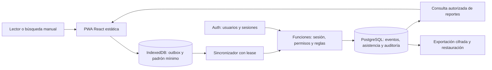
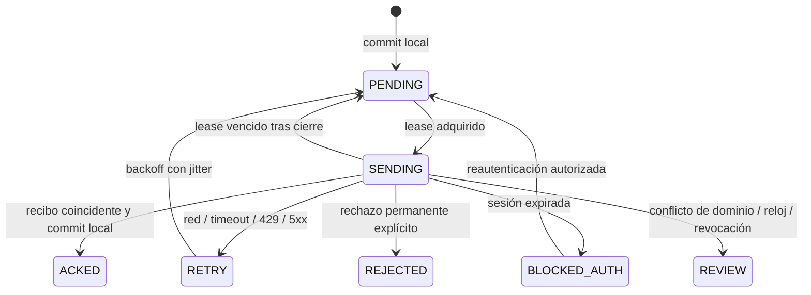

# SDD — Rediseño integral gratuito de SCA-QR

Versión 1.1 · Segunda revisión, 16 de noviembre de 2026 (America/Lima) · Estado: diseño propuesto, implementación pendiente.

SDD significa aquí **Software Design Document / Documento de Diseño de Software**. Este documento especifica el resultado deseado; no afirma que esas capacidades ya existan. Diagnóstico y evidencias: [ANALISIS_INTEGRAL.md](ANALISIS_INTEGRAL.md).

Código contrastado: `d44c688f79e46093a2eee105d7f1851682e10b48`. En esta segunda revisión pasaron 14 pruebas, TypeScript, lint y build; se validaron peticiones contra `npm start`, Chromium, la cola y un PDF de 100 filas. Se documentan 30 hallazgos, incluida ejecución de un marcador JavaScript inocuo mediante redirect de login sin validar. La aplicación sigue siendo un prototipo: esas comprobaciones no declaran preparación para producción.

Cambios de diseño frente a la versión anterior: conservar Next como opción estática preferente en vez de exigir Vite; corregir el registro del SW eliminado por la compilación; incorporar evidencia de caché privada y falsos éxitos en navegador; cerrar el contrato de firma JWS, la frontera de privilegios SQL y la reconciliación tras restore; cuantificar las cuotas gratuitas verificadas. No se han provisionado cuentas, aplicado migraciones ni publicado servicios.

## 1. Objetivo y restricciones

Convertir el prototipo en un sistema escolar que capture asistencia con conectividad intermitente, conserve cada evento, aplique permisos y genere reportes consistentes, sin contratar servicios pagados.

Restricciones obligatorias:

- Cero suscripciones de pago, VPS pagado, dominio comprado, tarjeta para habilitar consumo, pruebas temporales que luego cobren o activación automática de facturación.
- Usar planes gratuitos verificables o software libre en hardware disponible. Energía, conexión, equipos y horas de administración tienen costos aunque no sean servicios contratados; no se prometen como gratuitos.
- Si una cuota se agota, conservar pendientes y activar contingencia; nunca subir de plan automáticamente ni descartar asistencias.
- No publicar datos reales hasta verificar seguridad, permisos, restauración y condiciones del proveedor.
- Un único colegio como alcance inicial; incluir `school_id` para aislar datos, sin construir todavía un SaaS multiinstitución.
- Preservar operación básica sin correo, SMS, WhatsApp Business API, analítica externa, reconocimiento facial ni servicios de IA.
- Este trabajo produce documentación. No cambia código, infraestructura, configuración publicada ni cuentas externas.

Supuestos para dimensionar, sujetos a censo real: 1.000 alumnos, 2 entradas, 220 días lectivos/año, hasta 4 eventos/alumno/día incluyendo salidas. La documentación solicita 3–4 lectores por entrada y una laptop por entrada; conservar ese objetivo sin afirmar que los prefijos lo resuelven. El piloto usa un lector por laptop; completar el modo de varios lectores exige canales independientes comprobados y una fase específica. No presuponer que hay presupuesto o equipos para convertir ocho lectores en ocho laptops.

## 2. Alcance del producto

### Incluido

Padrón y matrícula por año; importación CSV validada; credenciales QR revocables; terminales y operadores; entrada/salida explícita; horarios y calendario escolar; almacenamiento offline; sincronización idempotente; revisión de rechazos; asistencia diaria; justificaciones/correcciones auditadas; dashboard; PDF/CSV; cuentas y roles; auditoría; backups y restauración; manual de contingencia y accesibilidad.

### Diferido

Portal de apoderados, múltiples colegios, aplicaciones móviles nativas, biometría, torniquetes, integraciones estatales, SMS y WhatsApp automatizados, monitoreo pagado, disponibilidad con SLA contractual. Las notificaciones por correo/Web Push son extensiones, no criterio de éxito del registro.

## 3. Arquitectura elegida y alternativa

### 3.1 Ruta principal: nube gratuita para piloto

**Frontend PWA estático en Cloudflare Pages + Supabase Free para Auth/PostgreSQL/funciones**, sujeto a verificar elegibilidad institucional, disponibilidad regional, cuotas efectivas y ausencia de cobro automático antes de provisionar. Usar subdominios gratuitos del proveedor. Los servicios son candidatos de planes gratuitos, no recursos que ya se hayan creado o contratado. La documentación oficial consultada confirma planes gratuitos y cuotas; no garantiza continuidad ni suficiencia para todo un año escolar.

Decisión deliberada: conservar React/TypeScript/Tailwind y **preferir Next con exportación estática** para reutilizar páginas y navegación. Actualizar primero a una versión mantenida y probar compatibilidad; la versión 14.2.15 auditada no es el objetivo de producción. Extraer las rutas API al backend, transformar `admin/layout.tsx` para no leer cookies en servidor y retirar el middleware de la distribución estática. La autorización real reside en backend/RLS; una guarda de navegación cliente solo mejora UX. `next/link` y los hooks cliente compatibles pueden conservarse. No basta con añadir `output: 'export'` al proyecto actual: primero debe desaparecer la dependencia de handlers y autenticación de servidor dentro del frontend.

Vite queda como alternativa si una prueba de exportación demuestra un bloqueo o el equipo decide simplificar a SPA. No es requisito para reparar IndexedDB, la cola, QR o persistencia. Antes de decidir una reescritura, comparar esfuerzo y funcionalidad con esta exportación y con Next/Node en un equipo institucional.

Un backend pequeño implementado en Supabase Edge Functions valida tokens y ejecuta operaciones PostgreSQL transaccionales. La lógica de negocio vive en TypeScript independiente del framework y las transacciones/invariantes críticas en funciones SQL. Usar una función HTTP agrupada por dominio cuando convenga; no crear microservicios por cada entidad. PDF se genera en el navegador desde un snapshot autorizado con una biblioteca libre compatible; migrar PDFKit Node es trabajo explícito, no asumido.

El uso público de claves publishable/anon no sustituye autorización. El frontend jamás contiene `service_role`, secretos JWT o claves privadas QR. RLS por institución/permiso en todas las tablas expuestas; no permitir INSERT directo de asistencia con rol de cliente.

Frontera de confianza elegida para escrituras: la Edge Function verifica el access token contra el servicio de identidad, deriva `actor_id` sin tomarlo del body, comprueba terminal y firma y llama una RPC transaccional **ejecutable solo por el rol de servicio**. Revocar EXECUTE a PUBLIC, anon y authenticated; quitar también permisos de escritura directa a tablas. La transacción vuelve a comprobar membresía activa, colegio, terminal y permisos para ese actor. El rol de servicio puede saltarse RLS: por ello sus comprobaciones explícitas son obligatorias, no se atribuye su protección a RLS. El acceso de lectura del usuario usa su JWT y políticas RLS. Si la RPC necesita SECURITY DEFINER, fijar search_path y propietario/permisos mínimos; no basar actor en auth.uid() de un token service_role ni aceptar claims construidos por el cliente. Probar que invocar la RPC directamente con JWT de usuario no evita la verificación QR.



### 3.2 Ruta de contingencia: software libre en equipo existente

Si el plan gratuito no admite el colegio, sus cuotas no alcanzan o su continuidad resulta insuficiente, ejecutar PostgreSQL + API Node + PWA estática + proxy HTTPS en un equipo institucional disponible. Reutilizar la misma lógica de dominio, esquema SQL y contratos; implementar adaptador de identidad/sesiones para no depender de Supabase Auth en esta ruta. Desplegar como **modo alternativo con un solo escritor**, nunca dos bases independientes que luego se intenten fusionar manualmente.

PostgreSQL y el stack React/Next no requieren licencias pagadas de esos componentes; revisar licencias concretas de nuevas bibliotecas y fuentes. El colegio aporta máquina, energía, red, actualizaciones y copias. En LAN se necesita un origen seguro que los navegadores confíen: un certificado de CA institucional instalado en terminales administradas es posible; un HTTP por IP privada no habilita normalmente service workers. No exponer el equipo por puertos públicos sin una revisión adicional. El acceso remoto es opcional y no necesario para la asistencia local.

La migración de nube a local requiere pausa controlada, drenaje/exportación de pendientes, backup, importación, reconciliación de conteos y nuevo origen autorizado; cambiar de dominio **no traslada IndexedDB**. Exportar/importar pendientes mediante herramienta de migración verificada antes del cambio. Esta alternativa elimina dependencia de un plan cloud, pero no promete infraestructura física sin costo ni alta disponibilidad.

### 3.3 Servicios y costo permitido

| Necesidad | Elección inicial | Regla de gratuidad y alternativa |
|---|---|---|
| Hosting PWA | Cloudflare Pages, estático | Verificar free y condiciones institucionales; servir local si deja de cumplir |
| Datos y autenticación | Supabase Free | Validar tamaño, conexiones, inactividad, Auth, exportación y límites de funciones; PostgreSQL/API local como salida |
| Imágenes | Sin foto obligatoria en MVP; iniciales | Fotos comprimidas en storage privado solo si hay consentimiento, cuota y política de acceso |
| Reportes | CSV/PDF generado con librerías libres | Sin servicio externo de PDF; límites de filas y prueba de paginación |
| Notificaciones | Bandeja interna | Sin dependencia de mensajería externa |
| Correo | Deshabilitado inicialmente | SMTP/Resend gratuito solo tras verificar dominio/remitente, cuotas y entrega; no comprar dominio para activarlo |
| Pruebas | Vitest, Playwright y k6 locales | CI gratuito solo dentro de cuota; suite local siempre disponible |
| Logs | Logs estructurados sin PII + visor local | Retención acotada; sin SaaS obligatorio |
| Backups | Exportación cifrada en almacenamiento institucional | Dos copias controladas; no confiar en backups incluidos en un free tier sin verificar |
| DNS/HTTPS cloud | Subdominio del proveedor | Sin dominio propio pagado |
| Redis | No necesario | Índices PostgreSQL y caché local acotada primero |

Vercel Hobby no es elección base: su elegibilidad de uso institucional/comercial debe verificarse; no asumir que cualquier proyecto escolar califica. Workers/OpenNext tampoco es requisito: la arquitectura estática evita condicionar el núcleo a compatibilidad de Next SSR y cuotas de CPU edge. Servicios de prueba y créditos de bienvenida no son una solución gratuita permanente.

### 3.4 ADR: comparación de rutas sin servicios pagados

| Alternativa | Reutilización | Límite o trabajo adicional | Decisión |
|---|---|---|---|
| Next estático + Supabase + Pages | Conserva páginas/links; extrae backend y sesión | Export estático, CORS, RLS/RPC, cuotas DB y backup propio | Objetivo cloud preferido, tras spike de exportación |
| Next/Node + PostgreSQL en equipo disponible | Mayor reutilización del runtime actual | Equipo encendido, HTTPS, mantenimiento y copias | Ruta válida si hay equipo y responsable; no depende de un VPS pagado |
| Vite SPA + Supabase + Pages | Conserva componentes React | Cambiar routing, layouts y build; mismas necesidades de seguridad/BD | Alternativa, no migración obligatoria |
| Next SSR en Workers/OpenNext | Conserva parte del servidor | Validar adaptador, CPU, bibliotecas Node/PDF y sesiones | No elegida para el primer piloto |

Las correcciones P0 se pueden implementar y probar en el checkout Next actual antes de escoger alojamiento. La aplicación no obtiene persistencia ni seguridad por cambiar de framework.

### 3.5 Puerta de decisión antes del despliegue

Registrar en un acta técnica la fecha y evidencia oficial de: uso institucional permitido; no requerir tarjeta; cuotas DB/egress/funciones/auth/storage/builds; suspensión por inactividad; política de borrado; exportación; región; transferencias de datos; límites de conexiones y duración; retención de logs; copias incluidas; comportamiento al exceder cuota. Elegir ruta local si alguna condición impide operar dentro del presupuesto.

Los sitios comerciales consultados devolvieron 403, pero sí se recuperó el contenido oficial de documentación mediante los repositorios públicos de Cloudflare y Supabase. Las cuotas verificadas se consignan en la sección 13 y las URLs en la 19. El acta de cuenta, elegibilidad y región sigue siendo criterio de despliegue, no requisito para escribir código ni para pruebas locales. No es necesario cambiar la configuración de red del entorno para utilizar esas fuentes.

## 4. Requisitos verificables

| ID | Requisito | Criterio de aceptación |
|---|---|---|
| RF01 | Padrón y matrícula | Importación con preview, errores por fila, unicidad y confirmación; no importar parcialmente sin informe |
| RF02 | Credenciales | Emisión, expiración, reemplazo y revocación; QR sin DNI ni nombre |
| RF03 | Captura durable | Cada captura admitida queda en IndexedDB antes de indicar almacenamiento local |
| RF04 | Confirmación | Verde definitivo solo si existe ACK de servidor persistido y consistente |
| RF05 | Idempotencia | Misma terminal/ID/hash devuelve mismo resultado; distinto hash con mismo ID se rechaza |
| RF06 | Offline | Reiniciar navegador sin red conserva pendientes y permite capturar con autorización offline vigente |
| RF07 | Sincronización | Reintentos no pierden eventos; rechazos quedan visibles y exportables |
| RF08 | Asistencia | Estado diario consistente con matrícula, calendario y horario Lima versionado |
| RF09 | Control de acceso | Acceso anónimo no lee padrón ni escribe scans; rol sin permiso recibe 403 |
| RF10 | Auditoría | Cambios de padrón, credencial, permisos y asistencia registran actor y motivo |
| RF11 | Reportes | Resumen y detalle provienen del mismo snapshot/filtros; CSV/PDF coinciden |
| RF12 | Recuperación | Restaurar copia en BD aislada y reconciliar eventos/ACK sin duplicación |
| RF13 | Manual | Solo operador autorizado; motivo obligatorio; no falsificar firma QR |
| RF14 | Terminales | Un administrador habilita/revoca terminal y entrada; cliente no se autoasigna permisos |
| RF15 | Contingencia | Exportar pendientes sin marcarlos sincronizados; reimportación conserva IDs |
| RF16 | PWA real | Build de producción registra SW automáticamente; arranque offline frío tras instalación y ningún dato privado en Cache Storage |
| RF17 | Integridad del comando | Reusar event_id con otro payload no devuelve la asistencia de otro alumno |
| RF18 | Exportación completa | Dataset sintético >80 filas sale completo en PDF/CSV, con conteo y snapshot coincidentes |
| RF19 | Salud en vivo | Liveness/readiness no se prerenderizan ni usan timestamp estático; no incluyen PII |
| RF20 | Navegación segura | Login solo redirige a destinos internos autorizados; javascript/data y URLs externas no se ejecutan |

Objetivos no funcionales de piloto, todavía no medidos: captura local p95 ≤150 ms en terminal acordada; confirmación online p95 ≤2 s en red escolar; 10 eventos/s sostenidos durante 10 minutos y ráfaga de 30/s durante 30 s en pruebas con datos sintéticos. No son promesas de capacidad de un free tier. Si no caben en cuotas, reducir alcance o usar ruta local.

Cero pérdida de eventos cuyo almacenamiento local haya sido confirmado mientras el perfil/disco se mantenga íntegro; cero duplicación de efectos por reintentos; ninguna lectura entre instituciones. Offline objetivo de una jornada de hasta 24 h; cuota local configurable ≥5.000 eventos pendientes por estación, validada en los equipos. Llegar al límite bloquea nuevas confirmaciones locales y activa contingencia visible; nunca sobrescribe el evento más antiguo.

## 5. Módulos y organización propuesta

```text
apps/web/                 PWA: ingreso, administración, informes y configuración
packages/domain/         reglas puras, tipos, reloj y política de asistencia
packages/contracts/      Zod, esquemas de API y códigos de error
packages/local-store/    esquema IndexedDB, migraciones y outbox
packages/sync/           lease, backoff, ACK y reconciliación
backend/functions/      adaptadores HTTP/Auth y autorización
backend/migrations/     tablas, índices, RLS y transacciones
tests/integration/      PostgreSQL real y APIs
tests/e2e/              navegador, offline, roles y actualizaciones
ops/                    backup, restore y manual de contingencia
```

Es una organización lógica, no obligación de adoptar un gestor de monorepo complejo. Se puede mantener un único package manager y workspace. El dominio no importa Next, Supabase ni DOM; almacenes, reloj, identidad y firma se inyectan como interfaces. Comenzar con monolito modular; no añadir Kafka, Kubernetes, Redis ni colas externas.

## 6. Datos e invariantes

| Entidad | Campos principales | Invariantes |
|---|---|---|
| schools | id, name, timezone, settings_version | Timezone IANA; inicialmente America/Lima |
| profiles / memberships | auth_user_id, school_id, role, active | Rol administrado en servidor, no metadata editable por usuario |
| students | id opaco, school_id, code, nombres, estado, photo_ref | Código institucional único por colegio; DNI opcional restringido |
| enrollments | id, student_id, year, grade, section, schedule_id, vigencias | No superponer matrículas activas incompatibles |
| schedules / calendar_days | ventanas, tolerancia entera, vigencia, feriados | Regla versionada y día escolar explícito |
| credentials | id, student_id, kid, issued_at, expires_at, revoked_at | Una credencial revocada no vuelve a ser activa |
| terminals / scanners | id, school_id, entrance_id, enabled, capabilities | Entrada autorizada por servidor; lector pertenece a terminal |
| terminal_sessions | id, terminal_id, operator_id, expiry, revoked_at | Sesión temporal y revocable, sin secreto estático en frontend |
| scan_receipts | terminal_id, event_id, payload_hash, result, received_at | UNIQUE(terminal_id,event_id); resultado final durable |
| attendance_events | id, school_id, student_id, credential_id, terminal_id, direction, occurred_at, received_at, local_date, rule_version, disposition | Evento inmutable; FK y validación de pertenencia |
| daily_attendance | enrollment_id, local_date, first_entry, last_exit, state, version | UNIQUE(enrollment_id,local_date); proyección reconstruible |
| attendance_adjustments | event/day, actor, reason, before/after, created_at | Corrección append-only, no borrar historia |
| notifications | target_user, event_id, state, created_at | Sin dependencia del canal externo |
| audit_log | actor, action, entity, request_id, metadata_minimal, at | Sin contraseñas, tokens, QR completos ni PII innecesaria |

Instantes se guardan como `timestamptz` UTC; fecha escolar se calcula con `America/Lima`, independientemente del host. `occurred_at` declarado por cliente y `received_at` de servidor se conservan ambos, junto con calidad temporal y desfase observado. Nunca sobrescribir uno con otro.

Índices iniciales: `(school_id, local_date, student_id)` en eventos; `(school_id, received_at, id)` para paginación; `(school_id, year, active)` en matrícula según esquema final; credencial por ID y estado; únicos de recibos y proyección. Medir con EXPLAIN antes de agregar otros. Usar FKs compuestas o comprobaciones transaccionales para impedir relaciones entre colegios.

La idempotencia dura al menos la ventana máxima de reenvío/importación y restauración; no expira arbitrariamente a las 24 h. Mantener un tombstone compacto ID/hash/resultado cuando se archive el detalle. La retención definitiva se aprueba institucionalmente y se dimensiona antes del piloto. Un recibo REJECTED/REVIEW también reserva el ID/hash: corregir el comando exige un ID nuevo y vínculo al original. Resolver una revisión añade una adjudicación auditada; no reescribe silenciosamente el recibo emitido.

## 7. Transacción de captura y reglas escolares

1. Verificar sesión, terminal habilitada, operador y permiso; limitar tamaño y frecuencia antes de operaciones costosas.
2. Validar contrato, `event_id` UUID, pertenencia de lector/entrada y hash canónico del comando.
3. Iniciar transacción; insertar/reservar recibo con clave única. Una carrera espera la transacción propietaria y devuelve su resultado, no ejecuta dos escrituras.
4. Si el ID ya existe con otro hash, devolver IDEMPOTENCY_KEY_REUSED. Si coincide, devolver el recibo persistido.
5. Verificar firma QR, emisor, `kid`, vigencia y revocación; resolver alumno/matrícula. La selección manual usa otro comando con permiso y motivo.
6. Validar tiempo y calendario. Bloquear o enviar a revisión estados suspendido/graduado/inactivo según política explícita. Suspensión no debe impedir registrar una observación de seguridad: conservar el intento separado de asistencia admitida.
7. Crear la proyección diaria con INSERT ON CONFLICT DO NOTHING y después bloquear esa fila por matrícula/fecha con SELECT FOR UPDATE. Bloquear solo una fila inexistente no serializa el primer registro. Aplicar ventana antidoble lectura del servidor sin depender de `is_burst`.
8. Insertar evento aceptado/rechazado o referencia mínima de intento, actualizar proyección y escribir recibo final en la misma transacción.
9. Commit antes de devolver ACK. Si se pierde respuesta, reenviar el mismo ID recupera el mismo resultado.

Semántica de batch: cada evento tiene su propia transacción/recibo, no una transacción que aborte todo el lote por un rechazo. Procesar hasta 20 eventos con concurrencia inicial 2; para un mismo alumno/fecha respetar orden de captura o marcar secuencia ambigua para revisión. Ordenar adquisición de locks si una operación modifica varias filas. Reintentar deadlock/serialization failure con el mismo ID y límite de transporte, sin confirmar antes del commit.

`ENTRY` y `EXIT` proceden del modo autorizado de terminal o de una acción manual explícita, no se infieren por estar después de las 13:00. Antes del comienzo, una entrada es temprana, no EARLY_LEAVE. Para turno 07:00 con tolerancia 10 minutos: ≤07:10:00 es puntual; después, tarde, según precisión acordada. Un `EXIT` temprano puede marcar incidencia sin eliminar la presencia. EVENING tiene política explícita. La ráfaga genera una alerta de revisión; nunca desactiva deduplicación.

Ausencia se calcula al cierre/ventana de la jornada para matrícula activa y día lectivo. Antes se muestra “sin registro”, no ausencia definitiva. Justificaciones, feriados y permisos alteran la proyección con trazabilidad. El reporte usa esa proyección y permite consultar los eventos que la originaron.

Tiempo offline: enviar desfase estimado desde último contacto y monotonicidad local cuando esté disponible. Eventos fuera de jornada, demasiado futuros o con desfase sospechoso quedan en REVIEW con su hora original. Un cliente offline no ofrece hora confiable a prueba de manipulación; un operador autorizado resuelve las excepciones. No recalcular tardanza solo con la hora de sincronización.

## 8. Credenciales QR y captura física

Formato propuesto: `SCA1:<protected-header-base64url>.<payload-base64url>.<signature-base64url>`. El prefijo SCA1 identifica el formato de aplicación; los tres segmentos posteriores forman un **JWS compacto estándar**, no una firma artesanal sobre un payload. Header protegido: `alg: ES256`, `kid` y tipo de credencial fijado. Payload: `ver`, `iss` escolar opaco, `jti` de credencial aleatoria, `iat` y `exp` en segundos Unix. No incluir DNI, nombre ni teléfonos. No duplicar kid o algoritmo en campos no protegidos que puedan contradecirlos.

Usar biblioteca mantenida de JWS y WebCrypto en navegadores objetivo. El backend fija allowlist ES256, valida issuer y tipo, y resuelve kid exclusivamente desde claves públicas confiables de ese colegio; no descarga URLs de claves propuestas por el QR. La firma cubre header y payload según JWS. Preservar bytes del token y probar vectores válidos/alterados en cliente y servidor. Aumentar el contrato de tamaño a un máximo inicial de 1.024 caracteres y comprobar carnets reales: el límite actual de 200 no puede asumirse suficiente para JWS. Calibrar timeout de captura para el token completo, no truncarlo ni reducir seguridad para cumplir un formato viejo.

Clave privada solo en backend o herramienta institucional de emisión protegida; pública distribuida a terminales con versión. Rotación permite verificar carnets aún vigentes, y revocación se publica en snapshot autenticado. Si no hay forma segura de alojar la clave privada sin plan pagado, emitir desde herramienta local institucional; nunca guardarla en el bundle. QR firmado estático puede copiarse: el operador coteja identidad; no prometer protección total contra suplantación.

Captura base: **un lector HID por estación** y un parser único con framing, longitud máxima, timeout y Enter. No rotar foco para “detectar” origen. Prefijos ayudan a atribuir mensajes completos pero no resuelven caracteres intercalados de dos teclados físicos. Un lector sin prefijo se identifica como único/configurado, jamás se inventa el ID de otro.

Para varios lectores en un equipo: prueba de compatibilidad por modelo. Preferir canales independientes mediante serial/Web Serial o un agente local libre con acceso a dispositivos, autenticado y con origen restringido. WebHID no da acceso universal a dispositivos en modo teclado. Hasta que la prueba simultánea demuestre aislamiento, no prometer 4 lectores por laptop. El panel muestra configurado, actividad reciente, conexión comprobada o desconocida, según evidencia real.

Este objetivo no se elimina del alcance: reservar el spike de hardware en fase 0 y la entrega del adaptador en fase 3 si el colegio confirma varios lectores por laptop. Un agente local requiere instalación por sistema operativo, canal autenticado, binding a loopback y allowlist de origen; no abrir un WebSocket local sin protección que cualquier web pueda usar. Elegir la estrategia según modelos y sistemas existentes, evitando comprar terminales adicionales como solución implícita. Si solo funciona un lector, declarar piloto reducido y bloqueo concreto del objetivo completo.

La simulación de hardware utiliza un entorno de prueba o dry-run sin eventos de asistencia. El botón de sonido no llama al comando de registro.

## 9. Offline, IndexedDB y sincronización

Un único módulo abre la BD y crea **todos** los stores en migraciones acumulativas: outbox, receipts, students, credentials_snapshot, metadata, recent_scans y locks. Cerrar conexiones ante versionchange; mostrar instrucción de cerrar otra pestaña cuando haya blocked; nunca capturar errores de BD como una cola vacía. Migrar versiones 1/2/3 conservando registros y creando stores que falten incluso si el historial previo fue parcial.

Evento local mínimo: `event_id`, payload original/version, hash, terminal/scanner/entrance, método QR/manual, occurred_at, clock_quality, operator/session referencia, state, attempts, next_attempt_at y last_error estructurado. Un UUID se crea una sola vez, antes de persistir, y se usa en UI, red, ACK y reportes de soporte. No conservar secretos de sesión dentro de cada payload ni registrar QR completo en logs.



Persistir antes de enviar, tanto online como offline. UI azul/ámbar “guardado localmente, pendiente”; verde solo tras ACK; rojo rechazo; revisión con acción y explicación. Fallo de IndexedDB impide indicar que se guardó; ofrecer contingencia manual física, nunca falsa confirmación.

Un sincronizador por terminal/origen mediante Web Locks donde exista y lease transaccional IndexedDB como alternativa. Lease con expiración y recuperación; idempotencia del servidor sigue siendo la última defensa. Batches iniciales hasta 20, concurrencia baja configurable; backoff exponencial con jitter, respetar Retry-After. Timeout se limpia en finally. No hay máximo de intentos que borre eventos; después de umbral se pausa y avisa.

Cada respuesta debe contener event_id, payload_hash, disposition, receipt_id y server_timestamp. Un 409 genérico jamás autoriza eliminar un pendiente. REJECTED/REVIEW permanecen en bandeja; un ACKED solo se purga por política tras confirmación local y ventana de recuperación. Exportar pendientes no cambia su estado. Volver online dispara intento; también hay reintento al abrir la app y botón manual; no depender de Background Sync, que no está disponible en todos los navegadores.

Un ACKED local conserva, durante la ventana de recuperación, el payload canónico mínimo necesario y su recibo firmado por el servidor, no solamente un hash. Propuesta inicial: siete días calendario, sujeta a política y cuota; separar ese presupuesto de los 5.000 pendientes. Un hash no permite reconstruir un evento perdido por restauración. REJECTED/REVIEW se mantienen hasta resolución/política aprobada; 403 por terminal revocada bloquea envío y abre incidente, no descarta el evento.

Autorización offline: habilitar captura solo en terminal provisionada con permiso offline temporal, firmado, limitado a operador/terminal y una jornada. Offline no se puede comprobar una revocación nueva; mostrar ese límite. Un permiso vencido puede conservar datos pendientes pero no autorizar nuevas confirmaciones de acceso. La expiración de sesión no elimina eventos: se autentica de nuevo para enviarlos y el servidor valida el contexto original y cualquier revisión necesaria.

Padrón local mínimo, con versión, validez y ámbito; sin teléfonos/DNI si no son necesarios. Datos de un snapshot vencido solo permiten resultado provisional. Limpieza de sesión elimina snapshots sensibles cuando no se comprometa la recuperación de eventos; pendientes sobreviven a logout pero permanecen bloqueados y aislados. Un nuevo operador no accede a detalles de la cola sin permiso. Cifrado con clave guardada junto a los datos no protege frente a XSS; terminal administrada, disco cifrado, bloqueo y reducción de datos siguen siendo necesarios.

## 10. PWA y experiencia

Build estático con manifiesto de assets versionados y shell de ingreso precacheado. Registrar el SW desde un componente cliente con useEffect que invoque código del bundle del navegador. No usar `funcion.toString()` generada en servidor: el build actual la optimiza a una función vacía. Comprobar automáticamente registro, activación y controller sobre el HTML y JS compilados, no solo en modo dev. En Next export, traducir las cabeceras a configuración real de Pages (`_headers`) o del servidor local; `next.config.js.headers` no ejecuta un servidor en un hosting estático.

SW solo cachea allowlist de JS/CSS/iconos/sonidos públicos versionados; nunca `/auth`, APIs, panel privado, reportes ni respuestas con tokens/datos personales. El padrón offline se gestiona mediante IndexedDB y sus permisos, no mediante caché HTTP genérica. Datos sensibles: no-store y exclusión explícita del SW. Cache Storage no debe usarse confiando en que cache:no-store de fetch impida un cache.put manual. Prueba obligatoria: petición privada con sesión, logout y misma petición desde página controlada por SW debe recibir 401/403 sin recuperar datos antiguos.

La actualización anuncia nueva versión y espera al cierre de operación; evita recarga automática durante escaneo. Migraciones probadas con outbox pendiente y más de una pestaña. No usar skipWaiting incondicional para mezclar versiones incompatibles. Capturar fallos de precache y ofrecer diagnóstico, no declarar instalación completa al fallar.

Pantalla de portería: estado de API diferenciado de red, cola pendiente/revisión, última sincronización, vigencia del padrón y turno. Acción manual con motivo; confirmación de salida especial; acceso restringido a configuración. Zoom habilitado, teclado completo, foco visible, diálogos con trap/Escape/restauración de foco, aria-live moderado, contraste y reduced-motion. Sonido habilitado mediante interacción y alternativa visual; no depender solo del color. Modo vertical y pantallas pequeñas soportados, fullscreen opcional.

Panel: alumnos/matrículas, credenciales, horarios/calendario, terminales, operador/roles, incidencias, correcciones, reportes y recuperación. Paginación por cursor y filtros accesibles. Mostrar zona horaria, fecha escolar, versión de reglas y cobertura de sincronización en informes; indicar si faltan terminales por sincronizar.

Un reporte utiliza un snapshot_id, fecha escolar, filtros y total verificables compartidos por dashboard/exportación. PDF completo con encabezados repetidos, números de página y total; si se divide por tamaño, ofrecer todas las partes y CSV completo. Nunca truncar a 80 filas como exportación definitiva. Escapar fórmulas de CSV (`=`, `+`, `-`, `@` y controles iniciales según formato) al exportar texto no confiable. El envío opcional de resúmenes usa la misma fecha/snapshot; destinatario sale de configuración autorizada, no de un input ignorado ni de body arbitrario. Reintentar carga limpia errores anteriores solo al recuperarse; logout limpia sesión y vuelve a login mediante navegación controlada, sin mostrar JSON como pantalla final. Validar redirect contra una allowlist de rutas internas.

Política de redirect: permitir únicamente rutas conocidas (`/admin/dashboard`, `/admin/scans`, `/admin/reports`, `/ingreso`), con origen/protocolo de aplicación y parámetros expresamente admitidos. Ante una URL inválida, externa, protocol-relative, javascript o data, navegar al dashboard por defecto. No pasar texto no confiable a router.push ni confiar solo en startsWith('/'). Probar después de login con un marcador DOM inocuo, verificando que no se ejecuta; el código actual sí lo ejecutó durante la auditoría.

## 11. Seguridad, permisos y privacidad

| Operación | Admin | Dirección | Secretaría | Portería |
|---|---|---|---|---|
| Usuarios/roles y terminales | Sí | Lectura de estado | No | Solo su sesión |
| Padrón/matrícula | Sí | Lectura | Edición/importación | Mínimo de alumnos autorizados |
| Emitir/revocar QR | Sí | Según delegación explícita | Sí | No |
| Registrar QR/manual | Según permiso operativo | No por defecto | Manual con motivo | Sí, terminal asignada |
| Corregir asistencia | Sí con motivo | Sí con motivo | Proponer corrección | No |
| Reportes/exportación PII | Sí | Sí | Ámbito autorizado | No |
| Auditoría y recuperación | Sí | Lectura limitada | No | Diagnóstico de su terminal |

Aplicar controles en backend y RLS, no solo en UI. Deshabilitar registro público de usuarios; primer admin por procedimiento institucional. Con Supabase Auth elegir flujo de contraseña/aprovisionamiento administrativo sin depender de correos masivos gratuitos; recuperación mediante proceso seguro administrado hasta disponer de SMTP gratuito validado. Sesiones cortas para administración, renovación controlada y terminales revocables. Para SPA con tokens en navegador, documentar exposición a XSS: CSP estricta, sin scripts de terceros, sin HTML no confiable, dependencias mantenidas y borrado al salir. No afirmar protección HttpOnly si se elige almacenamiento cliente.

Validación Zod compartida en versión mantenida, límites de body/batch **antes** de parsear colecciones no acotadas, validación de origen/CORS exacta y respuestas sin información interna. Para ruta local con cookies: HttpOnly/Secure/SameSite y CSRF/origen. En cloud con bearer: CORS no sustituye JWT, permisos ni protección XSS. Rate limit de login, emisión QR, búsqueda, importación y scan mediante controles disponibles del proveedor o contadores PostgreSQL acotados; no depender de Redis pagado.

Logs sin nombres, DNI, fotos, tokens o firmas; IDs internos y request_id. Separar secretos de cuentas de operador. Dependencias actualizadas a versiones mantenidas, lock reproducible y escaneo de advisories como control, no certificado de ausencia de vulnerabilidades. No mantener la clave demo como fallback.

La auditoría actual de dependencias de producción reporta next crítico, postcss transitivo alto y zod alto. La fase 1 debe actualizar toolchain y paquetes, resolver el conflicto Vitest/tipos Node y evaluar advisories según uso. No interpretar `fixAvailable:false` como ausencia de una solución: puede requerir migrar versión mayor y revisar compatibilidad. Un frontend estático reduce exposición del runtime Node pero no permite ignorar seguridad de build y dependencias cliente.

Definir con el colegio: finalidad, base legal/consentimiento aplicable, acceso de apoderados, conservación de eventos y fotos, tratamiento de menores, transferencias internacionales y respuesta a incidentes. QR opaco y minimización reducen exposición; no eliminan obligaciones legales. Retención propuesta para discusión: snapshots de terminal por una jornada, recientes limitados, eventos operativos 90 días y agregados por año escolar; **no aplicar purgas** hasta aprobación y restauración probada. Toda eliminación respeta conservación institucional y reclamaciones pendientes.

## 12. Contratos de API

Mantener versión `/v1` y adaptador que resuelva la URL real de funciones cloud o API local. OpenAPI se genera desde contratos. Todas las operaciones con datos escolares requieren sesión y permisos.

| Operación | Propósito |
|---|---|
| GET `/v1/health/live`, `/ready` | Liveness sin datos; readiness de dependencia con respuesta mínima y sin cache estática |
| GET `/v1/terminal/bootstrap` | Configuración autorizada, claves públicas, snapshot/versiones y hora del servidor |
| GET `/v1/students?cursor=...` | Búsqueda/padrón mínimo por ámbito |
| POST `/v1/scans/batch` | Eventos y recibos individuales; un rechazo no pierde el resto del lote |
| GET `/v1/scans/receipts?event_id=...` | Reconciliación tras timeout, limitada a terminal autorizada |
| POST `/v1/manual-attendances` | Marcación manual con motivo y permiso |
| POST `/v1/students/import/validate`, `/commit` | Preview y confirmación ligada al hash del archivo |
| POST `/v1/credentials`, `/revoke` | Emisión y revocación auditadas |
| GET `/v1/attendance/daily` | Proyección y filtros estables |
| POST `/v1/attendance/adjustments` | Corrección inmutable con control de versión |
| POST `/v1/reviews/{receipt_id}/resolve` | Adjudicación auditada con permiso, motivo e ID de operación nuevo; conserva recibo original |
| GET `/v1/reports/snapshot` | Datos mínimos para PDF/CSV consistente |
| POST `/v1/recovery/reconcile` | Importación de evidencia local firmada tras restauración, solo administrador y con preview |

Ejemplo de comando por evento:

```json
{
  "schema_version": 1,
  "event_id": "UUID",
  "terminal_id": "terminal-autorizada",
  "scanner_id": "lector-configurado",
  "direction": "ENTRY",
  "occurred_at": "2026-11-16T12:10:00Z",
  "clock_quality": "LAST_SERVER_OFFSET",
  "credential": "SCA1:protected-header.payload.signature"
}
```

El backend deriva colegio, operador y entrada de la sesión/configuración, y comprueba terminal/scanner del cuerpo. El hash se calcula sobre una representación canónica documentada, excluyendo campos de transporte variables; cambiar hora, dirección o credencial exige nuevo ID. No confiar en un hash declarado sin recalcularlo.

La referencia al permiso de captura original también forma parte del comando; mantener `captured_by` separado de `submitted_by` cuando otro operador recupera la cola con autorización. El request utiliza el JWT vigente en la cabecera, no un token de sesión antigua copiado en cada evento. CORS admite solamente orígenes de producción/preview autorizados y el adaptador web apunta a la URL de API configurada; no dejar `/api/...` apuntando al hosting estático, cuyo fallback podría devolver HTML con 200.

Respuesta individual: `{event_id,payload_hash,receipt_id,disposition:"ACCEPTED|REJECTED|REVIEW",attendance_status,reason_code,server_timestamp}`. Reenvío idéntico devuelve el recibo original más `replayed:true`. Errores de transporte usan `{code,request_id,retryable}`. JSON malformado 400; token ausente 401; permiso 403; contrato 422; reutilización de ID con otro payload 409; cuota/rate limit 429; indisponibilidad 503. Un 401 pausa envío, no reclasifica ni elimina asistencia. El cliente procesa el recibo, no solo el código HTTP.

## 13. Presupuesto de capacidad y límites gratuitos

### Cuotas verificadas en documentación oficial

Consulta: 16 de noviembre de 2026. Se recuperaron archivos de los repositorios oficiales indicados en la sección 19; cifras publicadas, no medición de una cuenta ni compromiso comercial. Verificar otra vez al provisionar y después de cambios de plan.

| Recurso | Cuota documentada para Free | Consecuencia de diseño |
|---|---|---|
| Supabase proyectos | Dos proyectos gratuitos, límite según organizaciones donde se es Owner/Administrator | Un piloto y un entorno de prueba si la cuenta lo permite; no asumir proyectos gratis ilimitados |
| Supabase base de datos | 500 MB por proyecto | Es el límite decisivo para eventos, recibos, índices y auditoría; no confundir con Storage |
| Supabase egress | 5 GB en la tabla de cuotas; guía de egress distingue 5 GB uncached / 5 GB cached | Presupuestar por tipo; no sumar como 10 GB fungibles ni asumir DB/API cacheadas |
| Supabase Auth | 50.000 MAU | Suficiente en hipótesis para operadores; no evita límites de email/Auth |
| Supabase Storage | 1 GB | No amplía la BD PostgreSQL; fotos deshabilitadas inicialmente |
| Supabase Edge Functions | 500.000 invocaciones por período mensual de cuota | Batch y consultas acotadas; incluir bootstrap/reportes y reintentos |
| Runtime Edge Functions | 256 MB, 2 s de CPU/request, 150 s wall-clock Free | No ejecutar PDF pesado ni grandes importaciones síncronas; máximo no es objetivo de latencia |
| Cloudflare Pages builds | 500 builds/mes, uno simultáneo en Free; timeout 20 min | Agrupar cambios; separar tests locales de deploy |
| Cloudflare Pages assets | 20.000 archivos y 25 MiB por archivo | Build estático pequeño; no alojar dumps ni reportes privados como assets |
| Cloudflare Workers, si se añadieran | 100.000 requests/día, 10 ms CPU/invocación | No es el backend elegido; no confundir sus límites con Supabase |

La guía de producción de Supabase advierte que puede pausar proyectos Free con baja actividad durante siete días y que sus backups no están disponibles para descargar en Free. La guía de backups recomienda exportaciones propias y copias fuera del proveedor. Planificar vacaciones y restauración manual: no sustituir un plan de continuidad por tráfico artificial para evitar pausas. Edge Functions no permite conexiones salientes a puertos 25/587; no diseñar envío SMTP directo desde esas funciones.

Siguen sin verificar desde una cuenta real: elegibilidad de uso escolar, región, tarjeta/no cobro automático, límites efectivos por organización y políticas aplicables. No activar un add-on para obtener IPv4, dominio, PITR, transformaciones de imagen o retención mayor. El dump debe usar una ruta de conexión gratuita y TLS verificado que realmente esté disponible para esa cuenta; probarla antes del piloto.

### Capacidad estimada y puerta de escala

Modelo de cálculo, no consumo medido: `N alumnos × E eventos/día × D días × bytes/evento efectivo`. Para 1.000 × 4 × 220 = **880.000 eventos/año**. Con 1 KiB/evento serían aproximadamente 859 MiB solo de eventos, sin recibos, índices, auditoría, auth, fotos ni copias. Incluso si un proveedor ofrece unos cientos de MB, no puede asumirse que cubra el año escolar completo.

Medir `pg_total_relation_size` con al menos 100.000 eventos sintéticos e índices reales. Contabilizar recibos/tombstones y auditoría por separado; nunca purgar deduplicación para simular ahorro. Con 90 días lectivos de detalle serían 360.000 eventos en el mismo escenario; sigue siendo necesario medir y comparar con cuota real. Un archivo externo sin restauración y control de acceso no es una solución de archivo.

Con los 500 MB documentados, **no se aprueba conservar el escenario anual completo en Supabase Free por defecto**. El piloto cloud es acotado. Para ampliar, demostrar mediante medición que matrícula, proyecciones, recibos y retención caben con margen, implementar archivo institucional consultable/restaurable sin perder evidencia ni deduplicación, o elegir la ruta local. No fraccionar arbitrariamente la información en cuentas gratis para eludir límites ni purgar asistencias para sostener una promesa de costo cero.

Fotos: 1.000 × 30 KiB ≈29 MiB originales; egress puede crecer por recargas. Deshabilitarlas en MVP si no caben. Egress del padrón = tamaño comprimido del snapshot × número de terminales × refrescos; usar versionado/deltas y refresco manual/político, no descargar todo cada scan. Polling administrativo se suspende con pestaña oculta. No usar realtime para cada contador si consultas agregadas bastan.

Presupuestar además los eventos ACKED locales durante siete días y sus recibos firmados. Ejemplo con dos terminales: 2.000 eventos/día/terminal × 7 × 1 KiB ≈13,7 MiB por terminal, más índices y pendientes. Es una aproximación para probar StorageManager.estimate/persist en el equipo objetivo, no una garantía del navegador. Eliminar cookies o cambiar de origen puede romper autenticación y acceso a esta recuperación; documentarlo al operador.

Umbrales operativos propuestos: aviso al 60%, plan de reducción/archivo al 75%, activar contingencia antes del 90%, siempre comparados con cuota real. Revisar semanalmente almacenamiento, tráfico, llamadas, builds y auth. Sin API gratuita de métricas, registrar revisión manual del panel. La ausencia de cobro automático no implica continuidad del servicio: un plan puede suspenderse o rechazar tráfico.

## 14. Operación, backups y recuperación

RPO objetivo cloud de 24 h para desastre de BD con backup diario; no confundirlo con garantía de cero pérdida por reinicio normal, que resuelve PostgreSQL. RTO objetivo de 4 h con operador disponible, a validar en simulacro. Si la institución exige RPO cero frente a pérdida total del proveedor, este diseño gratuito requiere replicación adicional y no lo promete.

Exportación diaria consistente de base mediante herramientas oficiales/pg_dump con TLS verificado y credencial de backup restringida. Cifrar antes de copiar; clave fuera de la copia y acceso solo al responsable. Dos ubicaciones institucionales distintas, rotación definida y prueba mensual de restore en BD aislada. No subir dumps de menores como artefactos públicos de GitHub ni a repositorios Git. Documentar también exportación de usuarios/configuración y objetos/fotos: un dump SQL no restaura por sí solo todos los servicios de Auth/Storage.

Tras restore pueden faltar eventos/recibos que el cliente ya confirmó después del último backup. Conservar localmente payload canónico mínimo **y** recibo firmado durante la ventana acordada; el recibo contiene event_id, terminal_id, payload_hash, resultado, versión de reglas y referencia temporal, y se firma con una clave de recibos distinta de la de carnets. Un ID/hash solo no recupera el dato. Mantener claves públicas históricas confiables para verificar recibos tras rotación.

Recuperación: detener escrituras, restaurar en base aislada, comparar conteos/hash y fecha de corte; inventariar terminales; importar evidencia mediante preview administrativo; verificar firma y hash, reinsertar únicamente efectos probados ausentes con su versión original y reconstruir proyecciones. Conservar por separado captured_by/submitted_by y actor de recuperación. No reenviar indiscriminadamente como asistencias nuevas bajo el horario o regla actual. Confirmar reconciliación antes de reabrir captura y no ejecutar dos escritores. Si no hay evidencia suficiente, registrar pérdida potencial y revisión manual; no inventar asistencias ni afirmar RPO cero. Ensayar tanto commit antes de respuesta como backup anterior al ACK.

Runbooks mínimos: servidor caído, proveedor pausado, cuota agotada, terminal perdida, expiración de sesión, reloj incorrecto, IndexedDB blocked/cuota llena, pérdida de red, carnet revocado, duplicados, importación incorrecta, cambio de origen, incidente de privacidad y restauración. Operación sin red usa pendientes y planilla de contingencia si se agota autorización o almacenamiento. Nunca usar un “éxito” simulado como alternativa.

## 15. Pruebas y criterios de salida

| Capa | Casos obligatorios |
|---|---|
| Dominio | Bordes 07:00/07:10/07:10:01, tarde/noche, feriado, suspensión, egreso, entrada/salida, justificación, medianoche UTC vs Lima |
| IndexedDB | BD nueva, migraciones desde 1/2/3 parciales, stores faltantes, versionchange, dos pestañas, cuota, cola pendiente durante upgrade |
| Sincronización | Timeout antes/después de commit, 401/403/409/429/503, respuesta corrupta, ACK de otro hash, reintentos y cierre durante envío |
| PostgreSQL | Mismo ID simultáneo, ID con otro payload, dos entradas simultáneas al mismo alumno, rollback sin ACK, RLS cruzada |
| Seguridad | Acceso anónimo, escalamiento de rol, terminal revocada, invocación directa de RPC y escritura de tablas con JWT cliente, QR alterado/expirado/revocado/kid desconocido, XSS en importación/redirect de login, CORS/CSRF según modo |
| E2E | Alta/importación → emisión → escaneo → ACK → dashboard → reporte; offline/reinicio/reconexión; búsqueda manual y revisión |
| PWA | Registro real desde el build compilado y controller activo, shell frío offline, assets actualizados, logout sin datos privados cacheados, actualización con pendientes |
| Hardware | Cada modelo, prefijos, teclado nacional, foco manual, lectura incompleta y simultánea; no certificar canales sin ensayo |
| Operación | Backup/restore, reconciliación tras restore, cambio de origen con pendientes, agotamiento de cuota |
| Carga/accesibilidad | Objetivos p95 y tasa acordados, teclado/zoom/contraste/lector pantalla, PDF/CSV de 100 y 1.000 filas completos, snapshot por fecha, destinatarios y estados recuperables |

CI propuesta: Node 24 LTS fijado a una versión mantenida, tipos compatibles y gestores alineados; npm ci sin flags de ignorar peers después de corregir dependencias; typecheck, lint, unit, integración con Postgres, build estático y Playwright smoke. El resultado actual con dependencias retenidas no demuestra npm ci limpio: el dry-run falla. Declarar Playwright y configuración en el proyecto cuando se implementen E2E, sin depender de la instalación global del entorno. E2E completo y carga pueden ejecutarse localmente para respetar cuota.

Separar validación y despliegue; no mantener el job SSH a VPS como default gratuito. Si hay jobs distintos, descargar el artefacto producido por el build y verificar checksum/manifiesto antes de desplegar. El bundle estático no debe contener mocks ni datos privados. Publicación atómica con assets coherentes y rollback compatible; no copiar `.next` incompleto sobre una instancia activa. PRs no confiables no reciben secretos. La acción actual es un commit de documentación, no publicación de aplicación ni activación de esa pipeline.

Salida a piloto: F01–F07, F10, F23, F24 y F30 cerrados con pruebas; dependencias mantenidas y triage F28; auth/RBAC/RLS/RPC verificados; reglas aprobadas; backup restaurado y reconciliado; cuotas y condiciones gratuitas verificadas; una estación y datos sintéticos primero. Reportes completos y salud dinámica deben verificarse antes de usarlos operativamente. Después, piloto controlado de una entrada con reconciliación diaria y planilla paralela durante cinco jornadas. Ampliar solo sin discrepancias sin explicar, sin pérdida de cola y con capacidad medida. La aprobación institucional para menores es independiente de que los tests pasen.

## 16. Migración y backlog por fases

Estimaciones orientativas para una persona con experiencia: 8–12 semanas de trabajo, sin fechas comprometidas; integración de hardware no estándar o depuración de proveedores puede ampliar plazo. No son costos de servicios ni sustituyen un plan tras conocer hardware y padrón.

| Fase | Entregable | Dependencias | Esfuerzo orientativo | Salida verificable |
|---|---|---|---|---|
| 0 | Inventario real, política escolar, spike hardware/exportación Next y elegibilidad gratis | Ninguna | 2–4 días | ADR de despliegue y viabilidad de varios lectores acordados |
| 1 | Toolchain mantenida, contratos, esquema IndexedDB y outbox | 0 | 5–8 días | Migraciones y fallos de red sin pérdida |
| 2 | PostgreSQL, auth, RBAC/RLS, transacción/ACK, retiro de demo | Contratos de 1 | 7–10 días | Concurrencia y acceso no autorizado probados |
| 3 | Reglas de jornada, JWS, terminales, sincronización/revisión y adaptador de varios lectores si es viable | 1–2, spike de 0 | 7–10 días base; adaptador por estimar | Flujo completo y revocación probados; alcance hardware explícito |
| 4 | Importación, panel, correcciones, PDF/CSV, PWA/accesibilidad | 2–3 | 6–9 días | E2E y reportes consistentes |
| 5 | Backups, restauración, seguridad, carga y piloto | 1–4 | 6–10 días + piloto | Acta de aceptación y contingencia ensayada |

Mantener rama de desarrollo y cambios pequeños revisables. Migrar fixtures demo a test; no importar mocks como datos productivos. Durante transición, un adaptador permite probar la UI contra contratos nuevos, pero solo existe un backend escritor por entorno. Convertir dependencias de servidor de Next una a una y probar exportación; no publicar un frontend estático que siga apuntando a rutas Next desaparecidas. Si el spike elige Vite, presupuestar aparte la migración de routing/layouts; si elige equipo local, presupuestar adaptador de identidad y servicio de backup. Esas rutas no son conmutadores ya implementados.

Migración real: validar/exportar padrón institucional; asignar IDs opacos; importar a staging; verificar conteos y errores; emitir credenciales; provisionar terminal; probar con datos ficticios; capacitación y piloto. No hay datos persistentes reales que migrar en el prototipo; si ya se usó, inventariar manualmente los registros locales antes de cualquier limpieza.

Rollback: conservar versión de frontend anterior compatible con el contrato, migraciones SQL aditivas y backup previo. No hacer downgrade destructivo de IndexedDB ni cambiar de origen sin recuperar pendientes. Si una versión falla, detener captura problemática y conservar outbox; no restaurar BD antigua sin reconciliar ACK posteriores.

## 17. Trazabilidad de correcciones

| Hallazgos del análisis | Diseño/entregable que los cierra | Evidencia exigida |
|---|---|---|
| F01, F12 | Esquema único, UUID único y lease | Migraciones parciales y dos pestañas |
| F02, F03, F07 | Outbox + transacción + recibo | Timeout tras commit, restart y restore |
| F04, F05, F06, F13 | QR firmado, Auth, RBAC/RLS y terminales | Matriz negativa de acceso y revocaciones |
| F08, F09, F15 | Dominio escolar y proyección | Casos horarios/calendario/estados |
| F10 | SW restringido y shell estático | Reinicio offline y privacidad tras logout |
| F11, F17 | Parser único, capacidad física comprobada y dry-run | Hardware sin atribución inventada ni efectos de prueba |
| F14, F16, F21 | Repositorio de alumnos y contratos | Búsqueda real, paginación, 400/422 y metadatos correctos |
| F18 | Toolchain y CI reproducibles | npm ci limpio y pipeline local/remota |
| F19 | Accesibilidad y responsive | Teclado, zoom, foco y contraste |
| F20 | Bandeja interna y estados reales de entrega | Simulación nunca reportada como entrega |
| F22 | Gestión, auditoría, backups y runbooks | Ensayo integral y restauración |
| F23 | Registro explícito del SW en componente cliente | Build producción registra y controla la página sin intervención de consola |
| F24 | Clave terminal/evento y hash canónico | Mismo ID/distinto alumno devuelve conflicto, no ACK anterior |
| F25, F27 | Snapshot de reporte, PDF completo y UX de recuperación | >80 filas, fecha elegida, logout y recuperación de error |
| F26 | Health dinámico no-store | Peticiones de producción sin HIT estático ni timestamp de build |
| F28 | Versiones mantenidas y triage de advisories | Instalación limpia, audit revisado y ausencia de riesgos altos sin resolver en superficie usada |
| F29 | Artefacto trazable y despliegue separado | Prueba de entrega/rollback sin VPS pagado por defecto |
| F30 | Allowlist de redirect tras login | javascript/data/URL externa rechazados y marcador DOM nunca ejecutado |

## 18. Decisiones pendientes que no bloquean el desarrollo local

- Cantidad real de alumnos, eventos, estaciones y modelos de lector; si existe equipo para alternativa local.
- Horarios, tolerancia exacta, reglas de salida, estado suspendido, feriados y responsables de corrección.
- Retención y tratamiento institucional de datos de menores; uso o exclusión de fotos y DNI.
- Condiciones actuales de los planes gratuitos y región elegida; cuota comprobada con esquema y carga representativa.
- Responsable de backup, custodia de claves y procedimiento de recuperación de cuentas sin correo transaccional.

Default hasta resolverlas: datos sintéticos, un lector por estación, America/Lima, sin fotos ni DNI en QR, sin correo externo y sin publicación de datos reales. No se exige un servicio de pago para avanzar.

## 19. Fuentes, evidencia y pendientes

### Fuentes oficiales recuperadas en la segunda revisión

Consulta: 16 de noviembre de 2026. Los enlaces apuntan al contenido mantenido por sus organizaciones en GitHub. Las ramas pueden cambiar: estos valores son una fotografía documental y deben comprobarse al desplegar.

- [Supabase — billing y cuotas Free](https://raw.githubusercontent.com/supabase/supabase/master/apps/docs/content/guides/platform/billing-on-supabase.mdx): dos proyectos, DB 500 MB, egress, Auth, Storage y funciones.
- [Supabase — egress](https://raw.githubusercontent.com/supabase/supabase/master/apps/docs/content/guides/platform/manage-your-usage/egress.mdx): distinción de cuotas cached/uncached.
- [Supabase — límites Edge Functions](https://raw.githubusercontent.com/supabase/supabase/master/apps/docs/content/guides/functions/limits.mdx): memoria, CPU, duración, secretos y restricciones SMTP.
- [Supabase — checklist de producción](https://raw.githubusercontent.com/supabase/supabase/master/apps/docs/content/guides/deployment/going-into-prod.mdx): posible pausa Free por baja actividad en siete días y limitación de backups descargables.
- [Supabase — backups](https://raw.githubusercontent.com/supabase/supabase/master/apps/docs/content/guides/platform/backups.mdx): exportaciones propias para Free y copias fuera del proveedor.
- [Cloudflare — límites Pages](https://raw.githubusercontent.com/cloudflare/cloudflare-docs/production/src/content/docs/pages/platform/limits.mdx): builds, tamaño y cantidad de assets.
- [Cloudflare — pricing Workers](https://raw.githubusercontent.com/cloudflare/cloudflare-docs/production/src/content/docs/workers/platform/pricing.mdx): cuotas Free de Workers, distintas del hosting estático y del backend Supabase.

### Referencias complementarias para implementación

Estas páginas no se presentan como verificadas exitosamente en esta revisión:

- [Supabase Pricing](https://supabase.com/pricing), [RLS](https://supabase.com/docs/guides/database/postgres/row-level-security) y [Auth](https://supabase.com/docs/guides/auth).
- [Vercel Hobby](https://vercel.com/docs/plans/hobby) y [Resend Pricing](https://resend.com/pricing), opciones diferidas; el SDD no depende de ellas.
- [Next static exports](https://nextjs.org/docs/app/guides/static-exports), [IndexedDB](https://developer.mozilla.org/en-US/docs/Web/API/IndexedDB_API), [Web Locks](https://developer.mozilla.org/en-US/docs/Web/API/Web_Locks_API), [WebHID](https://developer.mozilla.org/en-US/docs/Web/API/WebHID_API) y [Secure contexts](https://developer.mozilla.org/en-US/docs/Web/Security/Secure_Contexts).
- [JWS RFC 7515](https://www.rfc-editor.org/rfc/rfc7515), [PostgreSQL backup](https://www.postgresql.org/docs/current/backup.html) y [WCAG 2.2](https://www.w3.org/TR/WCAG22/).

La decisión final registra términos vigentes, cuenta y región. Las pruebas del código y sus límites constan en el análisis adjunto. El objetivo es operar dentro de recursos gratuitos y conservar una salida portable; no depender de que una oferta comercial permanezca igual para siempre.

## 20. Orden de implementación y definición de terminado

Primer PR: corregir redirect inseguro, registro SW y política de caché, unificar IndexedDB con migraciones que preserven datos y añadir regresiones del build, login y logout. Segundo PR: outbox para toda captura y UI sin confirmación prematura. Tercero: persistencia transaccional, hash/idempotencia y permisos reales. La actualización de dependencias y el aislamiento del modo demo se trabajan desde el inicio, antes de cualquier exposición de datos reales. Esta secuencia no despliega parcialmente un sistema inseguro a producción.

Cada PR declara requisito/hallazgo cerrado, pruebas positivas/negativas ejecutadas, compatibilidad de datos pendientes y rollback. No cerrar un hallazgo porque TypeScript o una prueba de helpers pase. Mantener separados el estado de desarrollo, el piloto y la aceptación institucional. El cierre de este documento consiste en un diseño versionado y revisable; implementar el SDD, desplegar y operar el colegio son trabajos posteriores.
